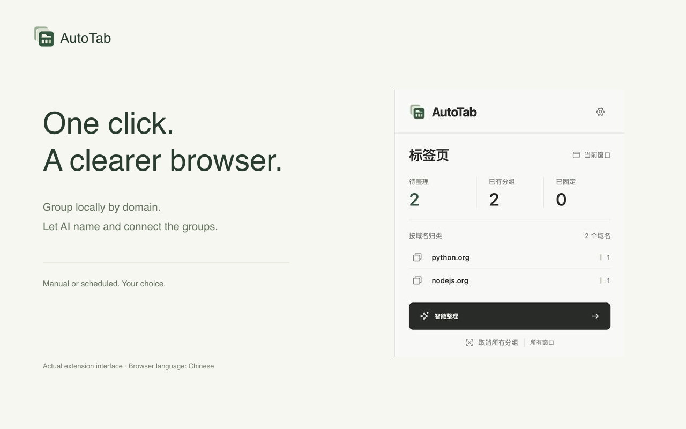

<p align="center"></p>

# AutoTab

**AI-assisted tab groups. Less clutter, more focus.**

English · [简体中文](README.zh-CN.md)

AutoTab is a Chrome extension that groups tabs locally by root domain, then uses your chosen AI service to name groups and merge related topics. Connect any **OpenAI-compatible** or **Anthropic-compatible** API with your own endpoint, model and key.

[Download](https://github.com/YeeZC/autotab/releases/latest) · [Privacy policy](https://yeezc.github.io/autotab/privacy.html) · [Report an issue](https://github.com/YeeZC/autotab/issues) · [Changelog](CHANGELOG.md)



## Features

- **Domain first, AI second.** Native Chrome groups appear immediately; lightweight model requests name and relate them.
- **Bounded requests.** Up to three title samples per domain, small comparison batches, and at most three concurrent requests.
- **Manual or scheduled.** Organize the current window on demand, or all regular windows at intervals of 30 seconds or more.
- **Keep control.** Protect pinned tabs and existing groups; ungroup all regular windows without closing tabs.
- **Your API.** Custom HTTPS endpoints plus localhost services; no bundled model account or developer proxy.
- **English and Chinese.** Interface language follows Chrome, with English as the fallback. Built-in prompts are written in English.

## Install

Chrome Web Store submission is awaiting review as of **November 20, 2026**. GitHub Releases can be installed manually in the meantime.

1. Download `autotab-0.3.1.zip` from [Releases](https://github.com/YeeZC/autotab/releases/latest) and extract it.
2. Open `chrome://extensions` and enable **Developer mode**.
3. Select **Load unpacked** and choose the extracted directory containing `manifest.json`.
4. Open AutoTab's settings, select an API format, enter the base URL, model ID and API key, and save. Approve access to that API origin when Chrome asks.
5. Open the popup and select **Organize tabs**.

To install from source, clone this repository and load its `extension/` directory. No build or dependency installation is required.

## Configure an API

| Format | Example base URL | Appended endpoint |
| --- | --- | --- |
| OpenAI compatible | `https://api.openai.com/v1` | `/chat/completions` |
| Anthropic compatible | `https://api.anthropic.com/v1` | `/messages` |

Use your provider's actual base URL and model ID. Include any required prefix, such as `/v1`, but omit the final endpoint. Local services can use `http://localhost:PORT` or `http://127.0.0.1:PORT`. Streaming-only or Responses-only endpoints are not supported.

The extension is free to install; model API usage is billed under your own provider's terms.

## Privacy and behavior

Naming requests include root domains, tab counts, temporary group IDs, your preferences and up to three sample titles per group. Relationship analysis sends group names, domains and summaries. AutoTab does not read page bodies or send full URLs or Chrome tab IDs to models. Titles and preferences can still contain sensitive information.

Requests go directly to the API you configure. Keys and settings stay in Chrome local extension storage, not sync storage; the extension does not implement an encrypted credential vault. Third-party retention and training practices depend on your provider. Read the [full privacy policy](https://yeezc.github.io/autotab/privacy.html).

Already grouped, pinned and incognito tabs are skipped by organization. Model failures preserve completed local groups. Ungrouping does not disable the schedule; switch off automatic organization if you want tabs to remain ungrouped. Chrome may delay alarms during sleep.

## Development

Requires **Node.js 20+**; use **Node.js 22+** for browser checks and icon rendering. Browser checks use Chrome; set `CHROME_PATH` if it is not installed at the default macOS path. Packaging requires `zip` and `unzip`.

```sh
npm test              # Unit and mocked integration tests; no paid model calls
npm run check         # JavaScript, manifest and locale syntax checks
npm run test:browser  # Real Chrome service-worker registration check
npm run test:ui       # UI interactions, locales and screenshot checks
npm run package       # Create dist/autotab-VERSION.zip
npm run icons         # Render PNG icons from the vector source
```

| Directory | Contents |
| --- | --- |
| `extension/` | Manifest V3 service worker, API adapters, popup, settings and bundled assets |
| `tests/` | Node.js tests for grouping, providers, localization, scheduling and icons |
| `scripts/` | Validation, browser checks, packaging and icon rendering |
| `docs/` | Public privacy policy and GitHub Pages assets |

## Feedback

Report bugs and feature requests in [GitHub Issues](https://github.com/YeeZC/autotab/issues). Include the extension version, Chrome version, API format and reproduction steps. Do not post API keys, private tab titles or sensitive URLs.

For privacy questions, contact **yeezhang.go@gmail.com**. Bundled third-party asset notices are in [extension/vendor/NOTICE.md](extension/vendor/NOTICE.md).
